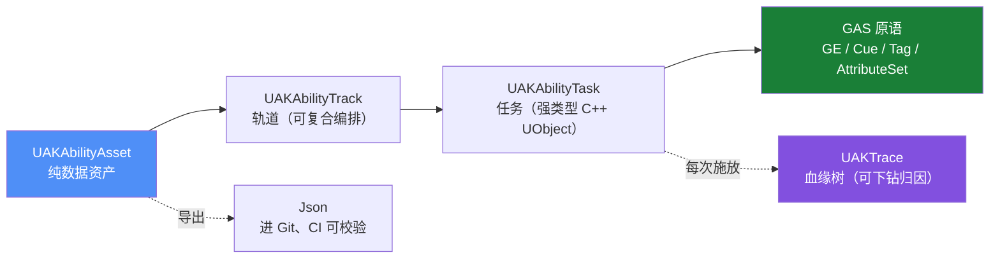

<div align="center">

# UEAbilityKit <sub><code>UAK</code></sub>

**基于 GAS 的 UE5 数据驱动技能时间轴编排框架**

_技能是一条时间轴，逻辑全部落到 GAS，配置是可 diff 的纯数据。_

[](https://github.com/HUSTJJD/UEAbilityKit/stargazers)
[](https://www.unrealengine.com/)
[](LICENSE)
[](https://hustjjd.github.io/UEAbilityKit/)
[](https://hustjjd.github.io/UEAbilityKit/)
[](https://github.com/HUSTJJD/UnLuaNova)

📖 **在线文档**：<https://hustjjd.github.io/UEAbilityKit/>

</div>

---

## 🎬 30 秒看懂



一段技能 = **一条时间轴 + 若干轨道**（Montage / GameplayEffect / GameplayCue / 碰撞检测 / 位移 / 分支 / 引导）。
运行时不另起炉灶——所有效果都落在 GAS 原语上，冷却、消耗、堆叠、预测、复制全部由 GAS 负责。

---

## ✨ 特性

| | 特性 | 说明 |
|---|---|---|
| 🎞 | **时间轴编辑器** | 自绘 `SUAKTimeline`：拖拽调时间、缩放、单帧步进、按帧显示、从 Montage 一键生成（Notify→Marker） |
| 🧩 | **复合编排** | 轨道级 `Timeline` / `Sequence` / `Parallel` + 重复次数 / 间隔 / 起始延迟；编辑器与运行时共用同一张调度表 |
| 🔒 | **引导 / 吟唱** | 窗口内维持条件（移动、距离、自定义），不满足即打断；失败动作可选取消 / 正常结束 / 跳到结尾 |
| 🌳 | **血缘树 Explain** | 每次施放生成 `UAKTrace`：技能 → 任务 → GE → SetByCaller → 目标，可逐层下钻回答"这 120 伤害哪来的" |
| 📄 | **配置可 diff** | 资产 ↔ Json 双向无损转换，进 Git、CI 可校验，告别二进制黑盒 |
| ✅ | **错误无法被配置出来** | 每个任务自带 `Validate()`，长度 / 越界 / 缺 GE / 引导窗口非法在保存前就被拦住 |
| 🌐 | **网络与预测** | `NetMode`（Server / Client / Both）逐任务控制；与 GAS 的 `LocalPredicted` 天然配合 |
| 🧪 | **测试随插件发布** | `UEAbilityKitTests` 模块 + 一键脚本，单元 / 实例 / GAS 三层用例，自动生成报告与 Showcase |

---

## 🆚 和现有方案的区别

| 方案 | 优点 | 短板 |
|---|---|---|
| **Able**（商业插件） | 时间轴编辑器体验成熟 | **不使用 GAS**：冷却 / 堆叠 / 被动全自建；网络无预测回滚；uasset 二进制不可 diff |
| **AbilityKit**（开源，Unity / C#） | 架构严谨：Pipeline、Triggering、Trace 溯源 | 是 Unity 项目，代码无法用于 UE；其回滚体系在 UE 里应让位给 GAS |
| **裸写 GAS** | 官方、可预测 | 缺可视化编排与调试工具，技能一多只能靠表驱动硬扛 |
| **UAK** | 时间轴编排 + GAS 原语 + 可 diff 配置 + 可溯源 | 需要理解 GAS 基础概念 |

**UAK 的定位**：用 Able 级别的编辑器体验，承载 AbilityKit 级别的架构思想，跑在 GAS 之上。

---

## 🚀 快速开始

<details open>
<summary><b>① 只想用插件</b></summary>

1. 把 `Plugins/UEAbilityKit` 拷到你项目的 `Plugins/` 下
2. `.uproject` 里启用 **UE Ability Kit**，并确保 **GameplayAbilities** 已启用
3. 重新生成工程文件并编译
4. 内容浏览器右键 → Miscellaneous → **Ability Asset**
5. 建一个继承 `UAKGameplayAbility` 的蓝图，指向该资产，用 ASC 授予并激活

</details>

<details>
<summary><b>② 直接跑示例工程</b></summary>

```bash
git clone --recursive https://github.com/HUSTJJD/UEAbilityKit.git
```

工程以 **Lyra 为宿主**（`LyraStarterGame.uproject`，先跑 `Tools/lyra.ps1 import` 导入），
布局参照 [UnLua](https://github.com/Tencent/UnLua)：**库放 Plugins，示例随库走**。

> 必须加 `--recursive`：脚本方案 [UnLuaNova](https://github.com/HUSTJJD/UnLuaNova) 自身还嵌套了 Lua / Luau 等子模块。忘了就补 `git submodule update --init --recursive`。

</details>

<details>
<summary><b>③ 跑测试</b></summary>

```powershell
./Tools/run_tests.ps1      # Windows：编译 + 跑用例 + 出报告
./Tools/run_tests.ps1 --filter UAK.Unit
```

```bash
./Tools/run_tests.sh       # Linux / macOS
```

</details>

---

## 🎮 示例宿主：改造后的 Lyra

UAK 是**技能模块**，Lyra 是被改造进来当示例的游戏：

```powershell
cd Tools
./lyra.ps1 import --lyra-path <你的 Lyra 目录>   # 下载好 Lyra 5.8 后跑这一条
./lyra.ps1 verify                            # 确认工程 = Lyra 原版 + 声明过的补丁
```

- **继承方向是 Lyra 继承 UAK**：`UGameplayAbility → UAKGameplayAbility → ULyraGameplayAbility`
  插件零依赖、可服务任何游戏；Lyra 只是其中一个宿主
- 拷进来的 Lyra 源码保持 Lyra 命名（保留 Epic 版权头），**只放 `Source/`，不进插件目录**
- `.uproject` 整个从 Lyra 拷来（本工程就是 Lyra）；`UAKDemo` 不再是独立工程，
  它降级为**插件的一个模块**（`Plugins/UEAbilityKit/Source/UAKDemo`），随插件分发
- 我们替换的是 Lyra 的技能实现，不是重新做一个游戏
- 资产（约 1.4 GB）由脚本从你本地的 Lyra 拷贝，不进 git；进 git 的只有源码 + 配置 + 技能 Json

详见 [docs/examples/lyra-integration.md](docs/examples/lyra-integration.md)。

---

## 🧪 测试与自动化

测试不是附属品，而是随插件发布的 `UEAbilityKitTests` 模块（Editor 类型，不进打包产物）。

**测试在本地一键跑，CI 只负责把结论发布到 Pages**（云端装 UE 跑测试不现实）。
`./Tools/run_tests.ps1` 一次跑完三个 stage：

| Stage | 进程 | 覆盖 |
|---|---|---|
| Editor | `UnrealEditor-Cmd` | `UAK.Unit.*` / `UAK.Instance.*` / `UAK.GAS.*` / `UAK.Media.*`（逐帧截图） |
| Game | `UnrealEditor-Cmd -game` | 真实游戏世界里的技能表现，逐帧录屏 |
| Net | 1 个 `-server` + N 个 `-game` | 各端导出 GAS 快照，比对**属性是否收敛到同一个值** |

| 层级 | 前缀 | 覆盖 |
|---|---|---|
| 单元 | `UAK.Unit.*` | Json 往返、校验规则、执行计划展开、编辑器元数据、查询过滤器 |
| 实例 | `UAK.Instance.*` | 真跑一次 `UAKAbilityInstance`：时序、门控、中断顺序、保证执行、循环、引导、Branch、溯源 |
| 集成 | `UAK.GAS.*` | 真的建 ASC 与属性集，验证 GE 落到属性、条件判定 |
| 表现 | `UAK.Media.*` | 逐帧截图 + 血缘树文本（没开采集时自动跳过） |
| 进程外 | `UAK.E2E.*` / `UAK.Net.Converge.*` | `UAK.Auto.*` 命令在 Game / DS 进程里的结论 |

"实例测试"的原则是**不 mock**：需要世界就建临时 `EditorPreview` 世界，需要 GE 就用 C++ 定义的 GE 类，所以没有内容资产也能跑出真实结论。

一次运行自动产出：

| 产物 | 路径 |
|---|---|
| 结论（Markdown / HTML / JSON） | `docs/reports/latest.{md,html,json}` |
| 截图 / 录屏（ffmpeg 合成） | `docs/reports/media/**` |
| 多端一致性表 | `docs/reports/latest.md` 的「多端一致性」章节 |
| Showcase（由素材自动生成） | `docs/showcase.md` |

详见 [docs/testing.md](docs/testing.md)。

---

## 📁 目录结构

```
UEAbilityKit/                       ← 仓库根 = UE 工程根
├─ LyraStarterGame.uproject         ← 宿主工程（Lyra 的，由 lyra import 复现）
├─ Source/LyraAdapt/                ← 适配层（唯一同时认识 Lyra 与 UAK 的地方）
├─ Plugins/UEAbilityKit/Source/UAKDemo/                  ← 示例模块（属性集 / 角色 / 技能，随插件分发）
├─ Plugins/
│  ├─ UEAbilityKit/                 ← UAK 插件（本仓库的主角）
│  │  └─ Source/{UEAbilityKit, UEAbilityKitEditor, UEAbilityKitTests}
│  └─ UnLuaNova/                    ← 脚本方案（git submodule）
├─ Tools/                           ← 唯一的脚本目录：shell 只是薄入口，逻辑全在 Python
│  ├─ lyra.ps1 / .sh                ← Lyra 唯一入口：import / clean / patch / verify
│  ├─ build.ps1 / .sh               ← 命令行编译（绕过 Build.bat 锁）
│  ├─ run_tests.ps1 / .sh           ← 一键测试（三 stage）
│  ├─ generate_tutorials.ps1 / .sh  ← 教程录制 + 文档生成
│  ├─ unluanova.ps1 / .sh           ← 脚本层：setup（一次写对）/ doctor（只读体检）
│  ├─ common.py                     ← 共用：路径 / 引擎定位 / 子进程
│  ├─ lyra/                         ← cli.py + import/clean/patch/verify + 补丁清单
│  ├─ build/                        ← build.py
│  ├─ test/                         ← run.py + report/
│  ├─ tutorial/                     ← run.py + generate_tutorials.py
│  └─ hygiene/                      ← check_no_local_paths.py
├─ Content/
│  ├─ AnimationAssets/              ← 角色与动画（来自 UnLuaNova 示例）
│  └─ Demo/Abilities/*.json         ← 技能资产示例（Json，可 diff）
├─ docs/                            ← 设计 / 示例 / 测试 / 报告 / Showcase
├─ mkdocs.yml                       ← GitHub Pages 站点配置
├─ LICENSE                          ← PolyForm Small Business 1.0.0
└─ LICENSE-COMMERCIAL.md            ← 商业授权说明
```

---

## 🔌 脚本层：UnLuaNova

示例工程的 Lua 脚本由 **[UnLuaNova](https://github.com/HUSTJJD/UnLuaNova)** 提供——它是 [Tencent/UnLua](https://github.com/Tencent/UnLua) 的**社区续作**，也是本仓库的兄弟项目（以 git submodule 引入）。

UnLua 的官方发布线冻结在 v2.3.6（2023-11），`develop` 上只有零星修复、没有版本号也没有维护者。UnLuaNova 把这些散落的社区成果收敛成一条有人维护的发行线，并在此基础上做三件事：

| | 亮点 | 说明 |
|---|---|---|
| ⚡ | **静态绑定** | 构建期为声明类型生成绑定表，绕开反射热路径与运行时查找开销；类型选择是 **opt-out**（默认全导出，不想要的加 `meta=(UnLuaNovaNoExport)`） |
| 🔁 | **双 Lua 后端** | [Lua 5.5](https://www.lua.org/) 与 [Luau](https://luau.org)（默认），均以子模块引入，共用一套后端抽象层 |
| 🔍 | **Lua 可观测性** | CPU Profiler 写入 Unreal Insights、`lua.dbg` headless 调试服务、`lua.sandbox` 沙盒、死循环看门狗 |
| 🧩 | **数据驱动绑定** | 类 → Lua 模块的映射写在 ini 里（或蓝图上加个绑定组件），**UE 侧一行代码都不用改**；不再是"必须实现 `IUnLuaNovaInterface`" |
| 🐛 | **IDE 里断点 / 单步** | `lua.dap start`：把 headless 的调试服务接成 DAP 服务，VSCode 直接 attach（断点 / 栈 / 局部变量） |
| 🩺 | **一键自检** | `Tools/unluanova.ps1 setup` / `doctor`：子模块、后端三处一致性、打包路径、扩展插件，机器替你查 |
| ♻️ | **热更新** | 编辑器内 HotReload、PIE 内非结构性改动热载；**运营期脚本下发**是 Lua 相对静态脚本方案的独占优势 |

**为什么值得试**

- 引擎支持 UE **5.4 / 5.6 / 5.8**；本示例工程即以 5.8.3 源码版编译通过
- 零胶水代码：直接访问 UCLASS / UPROPERTY / UFUNCTION / USTRUCT / UENUM，可替换蓝图里的 Event / Function
- 事件覆盖 Replication / Animation / Input，把"项目特有"的那部分逻辑留在脚本里迭代
- 从 UnLua 迁移只需把全局名 `UnLua` 批量换成 `UnLuaNova`

**和 AngelScript 怎么选**（一句话边界）：能接受**源码引擎分支** + 主机/PC 单机 + 不需要运营期热更，
Hazelight 的 UE-AngelScript 体验更完整（静态类型、VSCode LSP、断点单步一等公民）；
**不能 fork 引擎 / 要热更 / 团队已会 Lua**，UnLuaNova 是唯一现实解 —— 它是纯插件，零引擎改动。

```powershell
./Tools/unluanova.ps1 setup     # 一次把集成写对（幂等）
./Tools/unluanova.ps1 doctor    # 只读体检，有 error 退出码 1（可当 CI 门禁）
```

📖 在线文档：<https://hustjjd.github.io/UnLuaNova/>　·　⭐ 仓库：<https://github.com/HUSTJJD/UnLuaNova>

> UAK **不依赖**任何脚本系统：核心模块没有一行 UnLuaNova 依赖，示例模块 `UAKDemo` 也没有 ——
> 示例的 Lua 绑定是**配置**出来的（ini 里的类→模块映射），所以删掉 `Plugins/UnLuaNova` 整个目录
> 照样编译、照样跑测试。`.uplugin` 里那条引用仍标 `Optional`（缺了脚本插件也能启用）。
> 关掉它照样编译、跑测试、用插件；集成方式与分工见 [UnLuaNova 集成](docs/examples/04-scripting-with-unlua.md)
> 与 [集成契约](docs/design/20-scripting-integration.md)。

---

## 🗺 路线图

| 阶段 | 目标 | 状态 |
|---|---|---|
| M0 | 插件骨架 + 最小资产模型 | ✅ |
| M1 | 时间轴执行器 + GAS 桥接 | ✅ |
| M2 | 编辑器三视图（Timeline / Inspector / Bloodline） | ✅ |
| M3 | 治理：Validator + Json 双向 + CI 校验 | ✅ |
| M4 | 溯源：`UAKTrace` 血缘树与记录器 | ✅ |
| M5 | 高级编排：复合轨道 / 投射物与区域 / 打断传播 / 引导 | ✅ |
| — | 编译验证 + 单元测试 | ✅ UE 5.8.3 源码构建 |
| M6 | 运行时调试器 UI、更多内置 Task、编辑器打磨 | ✅（剩 PIE 人工走查） |

详见 [docs/roadmap.md](docs/roadmap.md)。

### M6 这一轮新增

| 能力 | 怎么用 |
|---|---|
| **运行时调试器** | 控制台 `UAK.Debug.Enable`（角色头顶浮字）/ `UAK.Debug.Summary`（打到日志）/ `UAK.Debug.Help` |
| **编辑器调试面板** | 窗口 → 开发者工具 → 调试 → **UAK Debugger**，每 0.1 秒刷新活跃技能与任务 |
| **溯源命令** | `UAK.Trace.Enable / Dump [N] / Clear / Disable`，血缘树直接打到日志 |
| **一键搭示例** | `UnrealEditor-Cmd.exe LyraStarterGame.uproject -run=UAKDemoSetup`：技能资产 + 蓝图 + 关卡 + 默认地图 |
| **新内置任务** | `ApplyLooseTags`（限时 Tag：霸体 / 无敌）、`FaceTarget`（转向目标 / 方向） |
| **编辑器打磨** | 任务复制 / 粘贴（Ctrl+C / V，剪贴板存 Json）、拖动吸附到 Marker |

> [!NOTE]
> 示例工程依赖的 [UnLuaNova](https://github.com/HUSTJJD/UnLuaNova)（Luau 后端）此前在 UE 5.8 的 PIE 阶段崩溃，现已随上游修复恢复可用。
> UAK 本体**不依赖任何脚本系统**——把 UnLuaNova 关掉也能编译、跑测试、用插件。

---

## 📚 文档

| 分类 | 入口 |
|---|---|
| 设计文档 | [设计总览](docs/design/00-index.md)（执行器 / 目标选取 / 溯源 / 网络 / 序列化 / 校验 / 复合编排 / 引导…） |
| 接入示例 | [最小多人配置](docs/examples/01-minimal-multiplayer-setup.md) · [冷却消耗堆叠](docs/examples/02-cooldown-cost-stacking.md) · [示例工程](docs/examples/03-sample-project.md) · [UnLua 脚本](docs/examples/04-scripting-with-unlua.md) · [跑通示例](docs/examples/05-run-the-demo.md) · [实况联调清单](docs/examples/06-live-trace-checklist.md) |
| 测试 | [docs/testing.md](docs/testing.md) |
| Showcase | [docs/showcase.md](docs/showcase.md)（由测试产物自动生成） |

**开发 / 验证环境**

| 项 | 值 |
|---|---|
| 引擎 | Unreal Engine **5.8.3**（源码构建） |
| 依赖插件 | `GameplayAbilities`（引擎自带） |
| 平台 | Win64 |

---

## 🙏 致谢与合规声明

- 架构思想参考开源项目 [AbilityKit](https://github.com/HOBOBO/AbilityKit)（MIT，Unity / 纯 C#）中关于技能管线、事件触发、溯源与配置治理的设计；**本项目为独立实现，未复用其任何代码**。
- 编辑器交互设计参考商业插件 **Able** 的**公开可见的交互模式**（时间轴 UX、验证器、预览视口等通用做法）；**未复用其任何源码、资源与文档文案**，且与其无隶属关系。
- 示例工程的脚本层由兄弟项目 **[UnLuaNova](https://github.com/HUSTJJD/UnLuaNova)**（MIT）提供——Tencent/UnLua 的社区续作，支持静态绑定、Lua 5.5 / Luau 双后端与 Lua 可观测性；`Content/AnimationAssets/` 中的 UE4 Mannequin 源自 Epic 示例内容。
- `Unreal®` 是 Epic Games, Inc. 的商标。本项目为社区独立项目，**非 Epic 官方产品，未获 Epic 认可**。

完整声明见 [NOTICE](NOTICE)。

## 📄 License

本项目采用 **PolyForm Small Business License 1.0.0**（源码可得 / Source Available，**非 OSI 开源许可**），见 [LICENSE](LICENSE)。

- **免费**：团队人数 < 100 人且上一税务年度总收入 < 1,000,000 USD（2019 年基准，按 CPI 调整）；个人学习、教学与非商业用途同样免费。
- **需付费**：超过上述规模 / 营收门槛的主体用于商业项目、外包交付、再分发或以本项目变现，须先取得商业授权。

商业授权范围、档位与联系方式见 [LICENSE-COMMERCIAL.md](LICENSE-COMMERCIAL.md)。

提交 PR 前请先阅读 [CONTRIBUTING.md](CONTRIBUTING.md) 并签署 [CLA](CLA.md)（企业贡献需 CCLA）。
第三方组件（`Plugins/UnLuaNova` 等）仍按其各自的 MIT / Lua / Epic 许可执行，详见该文档第 6 节与 [NOTICE](NOTICE)。
