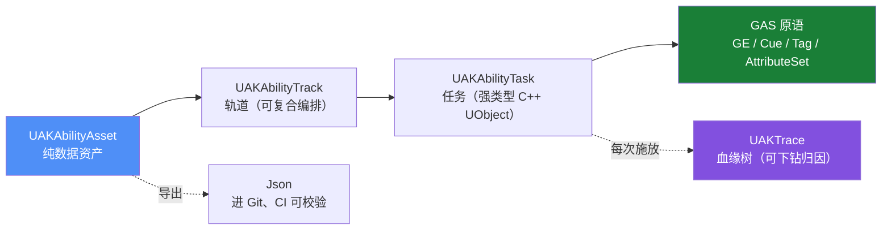

# UEAbilityKit（UAK）

**UEAbilityKit（简称 UAK）**：基于 Unreal Engine 5 与 Gameplay Ability System（GAS）的数据驱动技能编辑器与运行时工具集。

用时间轴编排技能：一段技能 = 一条时间轴 + 若干轨道（Montage / GameplayEffect / GameplayCue / 碰撞检测 / 位移 / 分支），运行时全部落在 GAS 原语上（`UGameplayAbility` / `UGameplayEffect` / `UGameplayCue` / `FGameplayTag` / `UAttributeSet`），不另起炉灶、不重复造轮子。

!!! tip "一句话定位"
    用 **Able 级别的编辑器体验**，承载 **AbilityKit 级别的架构思想**，跑在 **GAS** 之上。

---

## 30 秒看懂



---

## 核心能力

<div class="grid cards" markdown>

- :material-timeline-clock: **时间轴编辑器**

    自绘 `SUAKTimeline`：拖拽调时间、滚轮缩放、单帧步进、按帧显示、从 Montage 一键生成（Notify → Marker）

- :material-vector-combine: **复合编排**

    轨道级 `Timeline` / `Sequence` / `Parallel`，配重复次数、重复间隔、起始延迟；编辑器与运行时共用同一张调度表

- :material-lock-clock: **引导 / 吟唱**

    窗口内维持条件（移动 / 距离 / 自定义），不满足即打断；失败动作可选取消、正常结束或跳到结尾

- :material-file-tree: **血缘树 Explain**

    每次施放生成 `UAKTrace`：技能 → 任务 → GE → SetByCaller → 目标，逐层下钻回答「这 120 伤害哪来的」

- :material-file-document-edit: **配置可 diff**

    资产 ↔ Json 双向无损转换，进 Git、CI 可校验，告别二进制黑盒

- :material-shield-check: **错误无法被配置出来**

    每个任务自带 `Validate()`：长度、越界、缺 GE、引导窗口非法都在保存前被拦住

- :material-lan: **网络与预测**

    `NetMode`（Server / Client / Both）逐任务控制，与 GAS 的 `LocalPredicted` 天然配合

- :material-test-tube: **测试随插件发布**

    `UEAbilityKitTests` 模块 + 一键脚本：单元 / 实例 / GAS 三层用例，自动产出报告与 Showcase

</div>

---

## 设计原则

<div class="grid cards" markdown>

- :material-account-group: **GAS 一等公民**

    属性、Buff、修正、冷却、消耗、堆叠、表现解耦、网络预测，一律复用 GAS 原语

- :material-recycle: **不重复造轮子**

    移动 / 寻路 / 碰撞用引擎已有能力，只做「技能编排」这一层真正缺失的东西

- :material-source-branch: **数据可 diff**

    资产可导出为文本（Json）进 Git，CI 可校验

- :material-transit-connection: **运行时可溯源**

    技能 → 投射物 → 区域 → Buff → 伤害保留 root / parent / owner 血缘

- :material-movie-roll: **逻辑与表现分离**

    逻辑走 GE / Tag / Task，表现一律走 `UGameplayCue`

- :material-language-cpp: **C++ 优先，蓝图可扩展**

    核心 Task 用 C++ `UObject` 实现（强类型、可反射、可验证），允许派生蓝图 Task

</div>

---

## 和现有方案的区别

| 方案 | 优点 | 短板 |
|---|---|---|
| **Able**（商业插件） | 时间轴编辑器体验成熟 | **不使用 GAS**，冷却 / 堆叠 / 被动全自建；网络无预测回滚；uasset 不可 diff |
| **AbilityKit**（开源，Unity / C#） | 架构严谨：Pipeline、Triggering、Trace 溯源 | Unity 项目，代码无法用于 UE；其回滚体系在 UE 里应让位给 GAS |
| **裸写 GAS** | 官方、可预测 | 缺可视化编排与调试工具，技能一多只能靠表驱动硬扛 |
| **UAK** | 时间轴编排 + GAS 原语 + 可 diff 配置 + 可溯源 | 需要理解 GAS 基础概念 |

---

## 快速开始

=== "用插件"

    1. 把 `Plugins/UEAbilityKit` 拷到你项目的 `Plugins/` 下
    2. `.uproject` 里启用 **UE Ability Kit**，并确保 **GameplayAbilities** 已启用
    3. 重新生成工程文件并编译
    4. 内容浏览器右键 → Miscellaneous → **Ability Asset**
    5. 建一个继承 `UAKGameplayAbility` 的蓝图指向该资产，用 ASC 授予并激活

=== "跑示例工程"

    ```bash
    git clone --recursive https://github.com/HUSTJJD/UEAbilityKit.git
    ```

    仓库本身就是一个可打开的 UE 工程（`UAKDemo.uproject`），布局参照
    [UnLua](https://github.com/Tencent/UnLua)：项目即示例，库放 `Plugins`。

    !!! warning "别忘了 --recursive"
        UnLuaNova 自身还嵌套了 Lua / Luau 两个子模块。忘了就补
        `git submodule update --init --recursive`。

=== "跑测试"

    ```powershell
    ./Scripts/run_tests.ps1           # Windows
    ./Scripts/run_tests.ps1 -Filter UAK.Unit
    ```

    ```bash
    ./Scripts/run_tests.sh            # Linux / macOS
    ```

---

## 接下来读什么

<div class="grid cards" markdown>

- :material-map: [**路线图**](roadmap.md) — 里程碑与当前进度
- :material-book-open-variant: [**设计文档**](design/00-index.md) — 模型、执行器、目标选取、溯源、网络、序列化、校验…
- :material-school: [**示例**](examples/03-sample-project.md) — 最小多人配置、冷却 / 消耗 / 堆叠、UnLua 脚本
- :material-test-tube: [**测试与自动化**](testing.md) — 用例分层、一键脚本、报告与素材生成
- :material-image-multiple: [**Showcase**](showcase.md) — 由测试产物自动生成

</div>

!!! warning "已知问题"
    示例工程依赖的 UnLuaNova（Luau 后端）在 UE 5.8 的 PIE 阶段崩溃，已定位为上游问题并跟踪中。
    UAK 本体**不依赖任何脚本系统**，编译与单元测试均正常。

---

## 仓库

- GitHub：[HUSTJJD/UEAbilityKit](https://github.com/HUSTJJD/UEAbilityKit)
- License：PolyForm Small Business 1.0.0（源码可得 / Source Available，非 OSI 开源许可）；商业授权见 `LICENSE-COMMERCIAL.md`
- 贡献：需先签署 CLA，见 `CONTRIBUTING.md` / `CLA.md`
